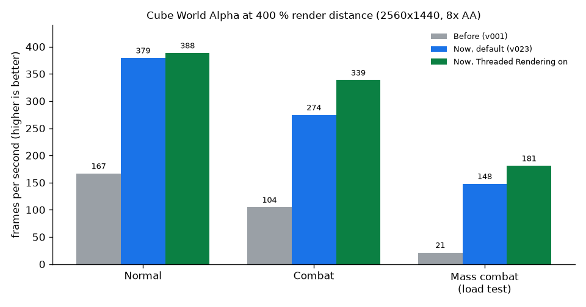

# Cube World Alpha – Performance

[English](PERFORMANCE.md)

Bei 400 % Sichtweite läuft das Spiel jetzt im normalen Spiel etwa **2,3-mal, im Kampf 2,6-mal und im großen Kampf
7-mal so schnell**, und die langsamsten Bilder (p99) sind 2,3- bis 6,5-mal kürzer. Spielablauf, Welterzeugung und Grafik
bleiben wie in der Original-Cube-World-Alpha, und Mehrspieler mit dem Original funktioniert weiter in beide Richtungen.
Die einzige Option, die Eingabeverzögerung kostet (Threaded Rendering, bis ~2,6 ms), ist standardmäßig aus.

| 400 % Sichtweite | Vorher (v001) | Jetzt, Standard | Jetzt, Threaded Rendering an |
| --- | --- | --- | --- |
| Normal – fps | 166,7 | **379,3** | 388,4 |
| Normal – p99 Bildzeit | 7,3–8,2 ms | **3,2 ms** | 3,2 ms |
| Kampf – fps | 104,5 | **274,4** | 338,6 |
| Kampf – p99 Bildzeit | 12,5–13,3 ms | **4,4–4,5 ms** | 3,7–3,8 ms |
| Massenkampf (Lasttest) – fps | 21,2 | **147,8** | 180,9 |
| Massenkampf – p99 Bildzeit | 53,1–53,3 ms | **8,2 ms** | 7,3 ms |

fps = Bilder pro Sekunde im Mittel, höher ist besser. p99 = 99 % aller Bilder sind schneller als dieser Wert, niedriger ist
besser. Wie gemessen wurde, steht unter [Messung](#messung).

## Was wir versprechen und wie es geprüft wurde

| Versprechen | Nachweis |
| --- | --- |
| **Spielablauf 1:1 wie im Original** | Die Welt entsteht genau wie im Original-Cube.exe: Die Karten sind bitgleich für die Seeds 10001 (311 Zonen) und 1507 (246 Zonen), und für Seed 123123 in 51 von 51 Zonen gegen eine Karte, die das Original frisch erzeugt hat. Die Original-Server.exe und unser Server erzeugen dieselben 6372 von 6372 Objekten in 172 Zonen, auch in Dungeons und Städten. Jede Änderung an der Spiellogik lief neben dem alten Code auf demselben Zustand: Pflanzen-Durchlauf 0 Abweichungen in ~100 000 Bildern, Wegsuche-Schlüssel 0 in 10 Mio. Operationen, offene Menge der Wegsuche 0 in 186 Mio. Vergleichen. Die Reihenfolge der Zufallszahlen ist unverändert. |
| **Grafik pixelgleich** | Jede sichtbare Änderung wurde mit angehaltener Uhr Bild für Bild verglichen, alt gegen neu. Eine Gegenprobe zeigte jeweils, dass der Vergleich Unterschiede auch findet. Zum Beispiel Kreaturen-Schatten: 0 abweichende Pixel, Gegenprobe 136 165 Pixel. Wolken-Markierungen im Massenkampf: 0 von 3 686 400 Pixeln. Alle Ergebnisse stehen in der Tabelle unten. |
| **Mehrspieler mit dem Original** | Getestet wurden unser Spiel an der Original-Server.exe und das Original-Cube.exe an unserem Server: Verbinden, einander sehen, Bewegung, Treffer, Chat. Der Windows-Build wurde zusätzlich an der Original-Server.exe geprüft. Die Netzwerk-Nachrichten sind unverändert. |
| **Keine zusätzliche Eingabeverzögerung im Standard** | Keine der Standard-Änderungen hält Bilder zurück. Nur das optionale Threaded Rendering kostet bis ~2,6 ms, weniger als ein Bild bei diesen Bildraten. Es ist standardmäßig aus. |

## Alle Änderungen

| Änderung | Warum (Engpass) | Wirkung (400 %) | Schalter (Standard) | Eingabeverzögerung | Gleiches Bild |
| --- | --- | --- | --- | --- | --- |
| Pflanzen: je Bild nur noch Lampen und rufende Pflanzen besuchen | jedes Bild ging alle Pflanzen durch | +68 % / +71 % fps (zwei Szenen) | Fast Plant Scan (an) | keine | ja, 0 Pixel (Gegenprobe 88) |
| Kreaturen-Schatten: 1 Zeichenaufruf statt 25 je Kreatur | Tausende winzige Zeichenaufrufe | Schatten 0,30 → 0,04 ms, +3–4 % fps | – | keine | ja, 0 Pixel (Gegenprobe 136 165) |
| Nachthimmel: Sterne in 1 Aufruf statt 3000 | 3000 Zeichenaufrufe nachts | Himmel 1,25 → 0,04 ms, nachts +21 % fps | – | keine | ja, 0 Pixel (Gegenprobe 1934) |
| Wegsuche-Schlüssel ohne Speicheranforderungen | Speicheranforderungen bei der Wegfindung | Kampf +5,9 % fps | – | keine | kein Einfluss aufs Bild; 0 Abweichungen in 10 Mio. Operationen |
| Lichtfelder der Chunks nur löschen, wo geschrieben | große Felder jedes Bild gelöscht | Lichter 0,275 → 0,105 ms | – | keine | ja, bitgleich |
| Offene Menge der Wegsuche ohne Nachschlagen | wiederholtes Nachschlagen | p99 4,82 → 4,64 ms | – | keine | kein Einfluss aufs Bild; 0 Abweichungen in 186 Mio. Vergleichen |
| Land und Wasser: Shader-Konstanten seltener hochladen | immer wieder dieselben Werte hochgeladen | Land 0,69 → 0,52 ms, Kampf p99 4,89 → 4,63 ms | – | keine | ja, 0 Pixel (Gegenprobe 3526) |
| Text der Bedienoberfläche aus einer Aufzeichnung | Text wurde jedes Bild neu gesetzt | Oberfläche 0,46 → 0,38 ms, Kampf +2,2 % fps | – | keine | ja, 0 Pixel (Gegenprobe 14 804) |
| Optionaler Zeichen-Thread | der Hauptthread macht Logik und Zeichnen allein | Kampf +23 % fps, wenn an | Threaded Rendering (aus) | bis ~2,6 ms, wenn an | ja, 0 Pixel (Gegenprobe 98) |
| Wegsuche-Knoten aus einer Freiliste | Speicheranforderungen bei der Wegfindung | Welt-Update 0,911 → 0,861 ms (fps-Gewinn nicht belegt) | – | keine | kein Einfluss aufs Bild; im Code geprüft |
| Wolken-Bodenmarkierungen: 1 Aufruf je Wolke | ein Aufruf je Feld | Massenkampf 29,8 → 145,3 fps | – | keine | ja, 0 von 3 686 400 Pixeln |
| Spike Log (Messwerkzeug) | Ursache von Rucklern finden | kostet < 0,01 ms je Bild | Spike Log (aus) | keine | zeichnet nichts |
| Eigene Einstellungsdatei `options-InfiniteCubes.cfg` | options.cfg des Originals bleibt unverändert | – | – | keine | – |
| Nur Linux: freigegebener Speicher bleibt zur Wiederverwendung | das System nahm Speicher zurück und gab ihn wieder aus | Kampf +6,1 % fps | abschaltbar über `GLIBC_TUNABLES` | keine | kein Einfluss aufs Bild |

Frühere Änderungen, die schon in der Mod waren und in diesem Projekt nicht gemessen wurden: Fast Terrain Loading (die
Landschaft lädt schneller: nach 20 s 1828 statt 200 Chunks) und Fast Creature Updates. Ebenfalls aus der früheren Arbeit
an der Mod stammen die Sichtweite bis 400 % (64 Bit), Plant/Creature Distance und Show FPS.

Korrekturen hin zum Original, ohne Einfluss auf die Geschwindigkeit: Zufallszahlen wie in Microsofts C-Laufzeit (unter
Linux), und Zufallszahlen in der Reihenfolge des Originals. GCC und MSVC werteten manche Ausdrücke anders aus, dadurch
waren Baumfarben, Dörfer und Beute anders.

Ausprobiert und verworfen, jeweils mit Bericht: Kreaturen bündeln (lohnt nicht), Pflanzen instanzieren (≤ 0,15 ms),
Compiler-Optionen (±0,4 %; Link-Zeit-Optimierung veränderte die Welt), Sperren zusammenlegen (änderte, was geladen wird).

## Options → Performance

| Schalter | Standard | Empfehlung |
| --- | --- | --- |
| Fast Creature Updates | an | anlassen |
| Fast Terrain Loading | an | anlassen |
| Fast Plant Scan | an | anlassen |
| Threaded Rendering | aus | Einschalten, wenn der Prozessor mindestens 4 Kerne hat und du mit großer Sichtweite spielst: Kampf +23 % fps, aber bis ~2,6 ms mehr Eingabeverzögerung. Bei 200 % war es 2,3 % langsamer. |
| Spike Log | aus | Nur einschalten, um Ruckler zu melden. Es schreibt `spikes.log`. |

Außerdem unter Options: Render Distance bis 400 % (64 Bit), Plant Distance, Creature Distance und Show FPS.

## Messung

- **Hardware:** AMD Ryzen 7 5800X3D, AMD Radeon RX 9070 Serie (Navi 48), Linux, native Linux-Version.
- **Einstellungen:** 2560x1440, 8x Kantenglättung, ohne fps-Limit, Sichtweite 400 % (Kreaturen 400 %, Pflanzen 100 %),
  Uhrzeit 11:30.
- **Kamera:** dreht sich gleichmäßig mit 36°/s, damit jede Blickrichtung gemessen wird.
- **Messfenster:** die letzten 60 s eines Laufs von 170 s (Kampf: 40 s von 150 s), nach dem Laden.
- **Szenen:**
  - *Normal:* ein Berg mit weiter Sicht.
  - *Kampf:* an einem See mit 3 Krabben und 3 Spittern. Die Figur verfolgt und bekämpft sie; in jedem Lauf wurden alle
    6 besiegt.
  - *Massenkampf:* ein Lasttest mit 30 Gegnern um die Figur, keine normale Spielsituation.
- **Läufe:** je Einstellung 2, die Versionen im Wechsel. Die Tabellen zeigen Mittelwert und Spannweite.
- **Grenzen:**
  - Gemessen wurde nur ein Rechner.
  - Der Windows-Build wurde nur grob unter Wine gemessen: ein Lauf bei 400 % ergab ~497 fps mit Threaded Rendering
    aus und ~580 fps mit an.
  - Wegen der Korrektur der Zufallszahlen haben v001 und v023 leicht andere Baumfarben und Dörfer.
  - Die Läufe fanden im Einzelspieler statt.

**Warum auch andere Rechner profitieren:** Fast alle Gewinne kommen daher, dass das Spiel weniger Arbeit macht: weniger
Zeichenaufrufe, weniger Hochladen auf die Grafikkarte und weniger Arbeit je Bild auf dem Prozessor. Das hilft mit jeder
Grafikkarte und jedem Prozessor. Langsamere Prozessoren gewinnen eher mehr, weil das Spiel bei großer Sichtweite auf seinen
Hauptthread wartet. Keine Änderung nutzt besondere Prozessor-Befehle. Die einzige Änderung, die einen zweiten freien Kern
braucht, Threaded Rendering, ist abschaltbar und standardmäßig aus.

## Bekannte Punkte

- Beim Ändern der Fenstergröße oder beim Fensterwechsel kann das Spiel abstürzen. Das ist ein alter Fehler, den es schon
  vor der Performance-Arbeit gab.
- Beim Zurückwechseln ins Spiel kann es einmal kurz hängen (bis ~0,2 s). Eine Lösung ist vorbereitet, aber nicht eingebaut,
  weil es das normale Spielen nicht betrifft.

## Nächstes Projekt

Netzwerk und Mehrspieler: Rubberbanding bei 400 % auf dem Server, Creature Distance auf der Serverseite und
Netzwerk-Optimierung. Kompatibilität mit dem Original bleibt Pflicht.
