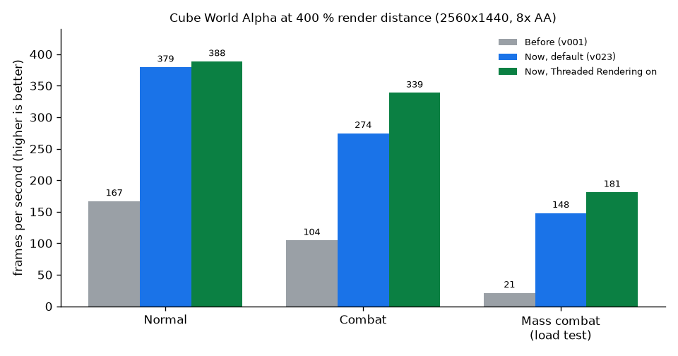

# Infinite Cubes Alpha Performance Boost

**Cube World Alpha mod: up to 7× more fps, 4× render distance, gameplay 1:1**

> **Built on [Infinite Cubes](https://github.com/coremaze/Infinite-Cubes) by coremaze.** Unofficial, not from Picroma.
> You need your own copy of Cube World Alpha; no game data is included.

[Deutsch](PERFORMANCE.de.md)

At 400 % render distance the game now runs about **2.3× as fast in normal play, 2.6× in combat and 7× in a large
fight**, and the slowest frames (p99) are 2.3–6.5× shorter. Gameplay, world generation and graphics stay the same as in
the original Cube World Alpha, and multiplayer with the original game still works in both directions. The only option that
adds input delay (Threaded Rendering, up to ~2.6 ms) is off by default.

| 400 % render distance | Before (v001) | Now, default | Now, Threaded Rendering on |
| --- | --- | --- | --- |
| Normal – fps | 166.7 | **379.3** | 388.4 |
| Normal – p99 frame time | 7.3–8.2 ms | **3.2 ms** | 3.2 ms |
| Combat – fps | 104.5 | **274.4** | 338.6 |
| Combat – p99 frame time | 12.5–13.3 ms | **4.4–4.5 ms** | 3.7–3.8 ms |
| Mass combat (load test) – fps | 21.2 | **147.8** | 180.9 |
| Mass combat – p99 frame time | 53.1–53.3 ms | **8.2 ms** | 7.3 ms |

fps = average frames per second, higher is better. p99 = 99 % of all frames are faster than this, lower is better. How
this was measured is described under [Measurement](#measurement).

## What we promise, and how it was checked

| Promise | Evidence |
| --- | --- |
| **Gameplay 1:1 like the original** | The world is generated exactly like the original Cube.exe: the maps are bit-identical for seeds 10001 (311 zones) and 1507 (246 zones), and for seed 123123 in 51 of 51 zones against a map freshly made by the original. Original Server.exe and our server create the same 6,372 of 6,372 objects in 172 zones, including dungeons and towns. Every change to game logic was run side by side with the old code on the same state: plant scan 0 differences in ~100,000 frames, path search keys 0 in 10 million operations, path search open set 0 in 186 million comparisons. The order of random numbers is unchanged. |
| **Graphics pixel-identical** | Each visual change was compared picture by picture with the clock stopped, old against new, and checked with a counter-test that the comparison does catch differences. For example, creature shadows: 0 differing pixels, counter-test 136,165 pixels. Cloud marks in mass combat: 0 of 3,686,400 pixels. All results are in the table below. |
| **Multiplayer with the original** | Our client on the original Server.exe and the original Cube.exe on our server were tested: connecting, seeing each other, moving, hitting, chat. The Windows build was also checked on the original Server.exe. Network messages are unchanged. |
| **No extra input delay by default** | None of the default changes holds frames back. Only the optional Threaded Rendering adds up to ~2.6 ms, which is less than one frame at these frame rates. It is off by default. |

## All changes

| Change | Why (bottleneck) | Effect (400 %) | Switch (default) | Input delay | Same picture |
| --- | --- | --- | --- | --- | --- |
| Plants: only lamps and calling plants are visited each frame | every frame walked over every plant | +68 % / +71 % fps (two scenes) | Fast Plant Scan (on) | none | yes, 0 pixels (counter-test 88) |
| Creature shadows: 1 draw call instead of 25 per creature | thousands of tiny draw calls | shadows 0.30 → 0.04 ms, +3–4 % fps | – | none | yes, 0 pixels (counter-test 136,165) |
| Night sky: stars in 1 draw call instead of 3,000 | 3,000 draw calls at night | sky 1.25 → 0.04 ms, at night +21 % fps | – | none | yes, 0 pixels (counter-test 1,934) |
| Path search keys without memory allocations | allocations in creature path finding | combat +5.9 % fps | – | none | no effect on the picture; 0 differences in 10 M operations |
| Chunk lights: clear only what was written | large arrays cleared every frame | lights 0.275 → 0.105 ms | – | none | yes, bit-identical |
| Path search open set without lookups | repeated lookups in path finding | p99 4.82 → 4.64 ms | – | none | no effect on the picture; 0 differences in 186 M comparisons |
| Land and water: fewer shader constant uploads | the same values uploaded again and again | land 0.69 → 0.52 ms, combat p99 4.89 → 4.63 ms | – | none | yes, 0 pixels (counter-test 3,526) |
| Interface text drawn from a record | text laid out again every frame | interface 0.46 → 0.38 ms, combat +2.2 % fps | – | none | yes, 0 pixels (counter-test 14,804) |
| Optional drawing thread | the main thread does logic and drawing alone | combat +23 % fps when on | Threaded Rendering (off) | up to ~2.6 ms when on | yes, 0 pixels (counter-test 98) |
| Path search nodes from a free list | allocations in path finding | world update 0.911 → 0.861 ms (fps gain not proven) | – | none | no effect on the picture; checked in the code |
| Cloud ground marks: 1 draw call per cloud | one draw call per square | mass combat 29.8 → 145.3 fps | – | none | yes, 0 of 3,686,400 pixels |
| Spike log (measuring tool) | find the cause of stutters | costs < 0.01 ms per frame | Spike Log (off) | none | draws nothing |
| Own options file `options-InfiniteCubes.cfg` | keep the original's options.cfg unchanged | – | – | none | – |
| Linux only: keep freed memory for reuse | the system took memory back and handed it out again | combat +6.1 % fps | can be switched off via `GLIBC_TUNABLES` | none | no effect on the picture |

Earlier changes that were already in the mod and were not measured in this project: Fast Terrain Loading (the landscape
loads faster: 1,828 instead of 200 chunks after 20 s) and Fast Creature Updates. These belong to the earlier mod work,
together with render distance up to 400 % (64-bit), Plant/Creature Distance and Show FPS.

Corrections towards the original, without a speed effect: random numbers as in Microsoft's C runtime (on Linux), and
random numbers drawn in the original game's order. GCC and MSVC evaluated some expressions differently, which changed
tree colours, villages and loot.

Tried and dropped, with reports: batching creatures (not worth it), instancing plants (≤ 0.15 ms), compiler options (±0.4 %; link-time
optimisation changed the world), merging locks (changed what gets loaded).

## Options → Performance

| Option | Default | Recommendation |
| --- | --- | --- |
| Fast Creature Updates | on | leave on |
| Fast Terrain Loading | on | leave on |
| Fast Plant Scan | on | leave on |
| Threaded Rendering | off | Turn on if your processor has at least 4 cores and you play at a high render distance: combat +23 % fps, but up to ~2.6 ms more input delay, and at 200 % it was 2.3 % slower. |
| Spike Log | off | Turn on only to report stutters. It writes `spikes.log`. |

Also under Options: Render Distance up to 400 % (64-bit), Plant Distance, Creature Distance and Show FPS.

## Measurement

- **Hardware:** AMD Ryzen 7 5800X3D, AMD Radeon RX 9070 series (Navi 48), Linux, native Linux build.
- **Settings:** 2560x1440, 8x anti-aliasing, no FPS limit, render distance 400 % (creatures 400 %, plants 100 %),
  daytime 11:30.
- **Camera:** turns evenly at 36°/s, so that every direction is measured.
- **Measuring window:** the last 60 s of a 170 s run (combat: 40 s of 150 s), after loading.
- **Scenes:**
  - *Normal:* a mountain with a wide view.
  - *Combat:* at a lake with 3 crabs and 3 spitters. The character chases them and fights; in every run all 6 were
    defeated.
  - *Mass combat:* a load test with 30 enemies around the character, not a normal game situation.
- **Runs:** 2 per setting, with the versions taking turns. The tables show the mean and the range.
- **Limits:**
  - Only one computer was measured.
  - The Windows build was only measured roughly under Wine: one run at 400 % gave ~497 fps with Threaded Rendering off
    and ~580 fps with it on.
  - Because of the random-number correction, v001 and v023 have slightly different tree colours and villages.
  - The runs were made in single player.

**Why other computers benefit too:** almost all gains come from doing less work: fewer draw calls, fewer uploads to the
graphics card and less work per frame on the processor. That helps on every graphics card and every processor. Slower
processors tend to gain more, because at a high render distance the game waits for its main thread. No change uses special
processor instructions. The only change that needs a second free core, Threaded Rendering, can be switched off and is off
by default.

## Known issues

- Resizing or switching the window can crash the game. This is an old bug that already existed before the performance work.
- Switching back to the game can cause one short hitch (up to ~0.2 s). A fix is prepared but not built in, because it
  does not affect normal play.

## Next project

Network and multiplayer: rubber-banding at 400 % on a server, Creature Distance on the server side, and network
optimisation. Compatibility with the original game stays a must.
